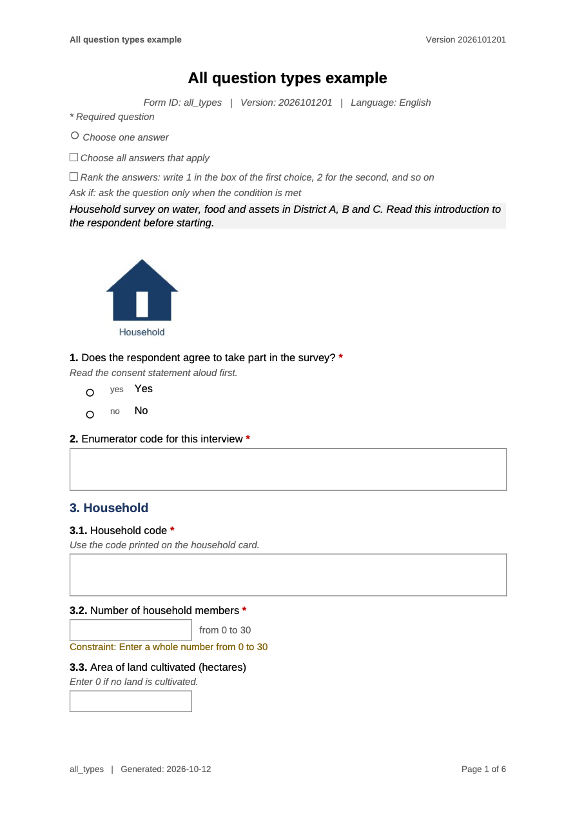
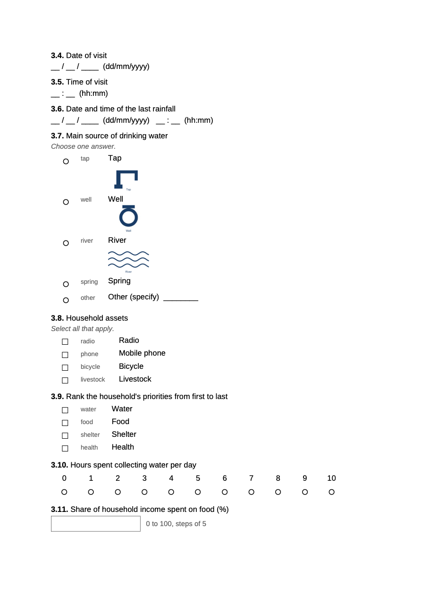

# convertxlsform

convertxlsform turns an XLSForm, the questionnaire format used by Open
Data Kit (ODK) and KoboToolbox, into a formatted paper version. Survey
managers can use the output to review a questionnaire with colleagues,
print it for interviewers, or check skip logic and constraints in one
readable document. It writes a Word file (`.docx`) by default, and a PDF
when LibreOffice or Microsoft Word is available. Forms can be
multilingual, and the paper version follows the language you choose.

|  |  |
|----|----|
|  |  |

*The bundled `all_types` example, converted to PDF.*

Full reference and articles:
<https://masud90.github.io/convertxlsform/>. New here? Start with the
[Getting
started](https://masud90.github.io/convertxlsform/articles/convertxlsform.html)
vignette.

## Installation

Install the released version from CRAN:

``` r

install.packages("convertxlsform")
```

Or install the development version from GitHub:

``` r

install.packages("remotes")
remotes::install_github("masud90/convertxlsform")
```

To install a specific release from GitHub, add its tag:

``` r

remotes::install_github("masud90/convertxlsform@v0.4.0")
```

Word output needs only R. PDF output needs one of the following:

- **LibreOffice** (free, all platforms). Install it, then run the
  command for your system:
  - macOS: `brew install --cask libreoffice`, or download it from
    <https://www.libreoffice.org/download/>.
  - Windows: download it from <https://www.libreoffice.org/download/>.
  - Ubuntu: `sudo apt install libreoffice-writer`.
- **Microsoft Word**, through the `doconv` package. Install `doconv`
  in R. convertxlsform uses Word only when LibreOffice is not found.

[`has_libreoffice()`](https://masud90.github.io/convertxlsform/reference/has_libreoffice.md)
detects LibreOffice only. Word is used through
`docx_to_pdf(engine = "word")` with `doconv`, and
[`convertxlsform()`](https://masud90.github.io/convertxlsform/reference/convertxlsform.md)
falls back to it when LibreOffice is not found.

## Quick start

**In R** (RStudio or any R session):

``` r

library(convertxlsform)

path <- system.file("extdata", "all_types", "all_types.xlsx",
                    package = "convertxlsform")

convertxlsform(path, output = tempdir())                  # Word file
convertxlsform(path, output = tempdir(), format = "pdf")  # PDF file
```

**From a terminal**, run the command with `Rscript`. Put the form path
and the options after the quoted expression:

``` sh
Rscript -e 'convertxlsform::cli()' form.xlsx --format pdf --lang bn
```

The package ships the example form above, which covers the question
types and features the package renders. Replace `path` with the path to
your own form, for example `convertxlsform("survey.xlsx")`. The output
is written next to the form, with the same base name and a `.docx` or
`.pdf` extension. The function returns the path of the file it wrote,
invisibly.

More terminal examples, Windows quoting and exit status

The bundled example works from the terminal too. The installed package
folder is usually read-only, so give an output folder:

``` sh
EXAMPLE=$(Rscript -e 'cat(system.file("extdata", "all_types", "all_types.xlsx", package = "convertxlsform"))')
Rscript -e 'convertxlsform::cli()' "$EXAMPLE" --format pdf --output .
```

The `Rscript -e '...'` examples use single quotes, which work in macOS
and Linux shells and in PowerShell. In Windows `cmd.exe`, use double
quotes outside and single quotes inside:

``` bat
Rscript -e "convertxlsform::cli()" form.xlsx --format pdf --lang bn
Rscript -e "cat(system.file('extdata', 'all_types', 'all_types.xlsx', package = 'convertxlsform'))"
```

Scripts that need the exit status (0 on success, 1 on error) can use:

``` sh
Rscript -e 'quit(status = convertxlsform::cli())' form.xlsx --format pdf
```

## What you get

- **Front matter:** the form title, version and form ID, the language,
  the date of generation, and a legend that explains the marks used in
  the document.
- **Groups:** headings numbered by depth. Repeat groups carry a “Repeat
  for each …” line that describes the repeat count.
- **Rosters:** a repeat group of up to six simple questions (text,
  numbers, choices, dates) is drawn as a table with one row per member
  and one column per question, with the code lists and skip logic below
  it. A fixed `repeat_count` sets the number of rows, otherwise
  `roster_rows` (default 5). Use `repeat_layout = "copies"` to print the
  questions instead, `repeat_copies` times.
- **Grids:** a group with the `table-list` appearance, or a `label`
  question followed by `list-nolabel` questions, is drawn as one grid
  with a row per question and a column per choice, when the questions
  share a choice list of up to eight choices.
- **Questions:** the number and label, a `*` for required questions, the
  hint in italics, and the variable name when
  `show_variable_names = TRUE`. “Ask if” and “Constraint” lines follow
  the answer area.
- **Single choice (`select_one`):** a hollow circle before each choice.
  Lists of seven or fewer choices print in one column; longer lists
  print in columns. When an answer skips later questions, the choice
  shows where to go next, for example “No → Go to Q5” (turn off with
  `include_skips = FALSE`).
- **Multiple choice (`select_multiple`):** a hollow square before each
  choice.
- **Rank:** a box beside each choice to write its rank.
- **Long choice lists:** when a list is longer than `max_choices`, the
  paper form shows a code box for the respondent to write the code, and
  a compact table of every choice with its code.
- **Text and numbers:** a bordered write-in box. Multiline text gets a
  taller box.
- **Date and time:** a printed pattern (`dd/mm/yyyy`, `hh:mm`).
- **Location:** latitude, longitude and accuracy fields for `geopoint`.
  `geotrace` and `geoshape` get a prompt and a reference line.
- **Media:** an image is printed at its size, scaled down to fit
  (questions up to 2 inches tall, choices up to 0.6 inches). A missing
  file prints a placeholder with its name, and convertxlsform warns
  about it.
- **Notes:** printed without a number.
- **Hidden types** (`calculate`, `start`, `end`, `deviceid` and similar)
  are left out unless `include_hidden = TRUE`.

## Languages

### How language columns are read

Translated columns carry the language in the header. convertxlsform
accepts any of these forms:

- `label::English (en)`: name and code. This is the form used in the
  bundled examples.
- `label::en`: code only.
- `label::English`: name only.

The same pattern works for `hint`, `guidance_hint`, `required_message`,
`constraint_message`, `image`, `audio` and `video`. A plain `label`
column (no suffix) is used when no translated column exists.

To list the languages in a form and see which one is the default:

``` r

xlsform_languages(system.file("extdata", "multilang", "multilang.xlsx",
                              package = "convertxlsform"))
```

The result has one row per language, with `suffix`, `code`, `name` and
`default`. It has no rows for a single-language form.

### Choosing a language

`lang` accepts a code, a name, or the full header suffix. If the
requested language is not in the form, convertxlsform warns, lists the
languages it found, and uses the default language instead.

To print two languages in one document, give the second with `lang2`.
Each label, hint, constraint message and choice of the first language is
followed, on a new line, by its translation:

``` r

convertxlsform(path, output = tempdir(), lang = "en", lang2 = "bn")
```

Forms in Arabic or Hebrew are laid out right to left. `rtl = TRUE` or
`rtl = FALSE` overrides the detection.

Within a language, a blank cell falls back in this order: the column for
the chosen language, then the plain column (for example `hint`), then
the column of the default language. A blank French hint, for example,
shows the English hint when the form has one.

### Connective phrases

Phrases such as “Ask if”, “Constraint” and “Repeat for each” come from
built-in tables. convertxlsform includes English and French. Any other
language uses the English phrases unless you supply translations with
`strings`.

To translate them, pass a named list. Only the names listed below can be
used, and an unknown name is an error:

| Name | English default |
|----|----|
| `ask_if` | Ask if |
| `constraint` | Constraint |
| `choice_filter` | Choices shown if |
| `repeat_for_each` | Repeat for each |
| `other_specify` | Other (specify) |
| `legend_required` | \* Required question |
| `legend_circle` | Choose one answer |
| `legend_square` | Choose all answers that apply |
| `legend_rank` | Rank the answers: write 1 in the box of the first choice, 2 for the second, and so on |
| `legend_ask_if` | Ask if: ask the question only when the condition is met |

The full list of names is in `R/strings.R`. A Bengali version of the
bundled multilingual form would look like this. The `"..."` values are
placeholders to replace with translations that you write or check with a
Bengali speaker:

``` r

path <- system.file("extdata", "multilang", "multilang.xlsx",
                    package = "convertxlsform")

convertxlsform(
  path,
  output = tempdir(),
  lang = "bn",
  strings = list(
    ask_if          = "...",  # Bengali for "Ask if"
    constraint      = "...",  # Bengali for "Constraint"
    choice_filter   = "...",  # Bengali for "Choices shown if"
    repeat_for_each = "...",  # Bengali for "Repeat for each"
    other_specify   = "..."   # Bengali for "Other (specify)"
  )
)
```

Until every placeholder is filled in, the paper form will show the
placeholder text.

## Options

R options: arguments of `convertxlsform()` and other options

**Arguments of
[`convertxlsform()`](https://masud90.github.io/convertxlsform/reference/convertxlsform.md)**

| Argument | Default | Meaning |
|----|----|----|
| `xlsform` | (required) | Path to the XLSForm (`.xlsx`, `.xlsm` or `.xls`). |
| `output` | `NULL` | Output file, or an existing folder. `NULL` writes next to the form. |
| `format` | `NULL` | `"docx"`, `"pdf"`, `"both"`, or `c("docx", "pdf")`. `NULL` takes the format from the extension of `output`, and uses `"docx"` when there is none. |
| `lang` | `NULL` | Language: a code (`"fr"`), a name (`"French"`) or the full header suffix (`"French (fr)"`). `NULL` uses the `default_language` of the settings sheet, or the first language found. |

An existing file is not replaced unless `overwrite = TRUE`.

**Other options (passed through `...`)**

| Option | Default | Meaning |
|----|----|----|
| `nested_serial_numbers` | `TRUE` | Number questions inside groups as 1.1, 1.2. `FALSE` gives flat numbers 1, 2, 3. |
| `include_relevants` | `TRUE` | Show skip logic as “Ask if: …”. |
| `include_constraints` | `TRUE` | Show constraints. |
| `include_hints` | `TRUE` | Show hints and guidance hints. |
| `include_choice_name` | `TRUE` | Show the choice code after each choice label. |
| `show_variable_names` | `FALSE` | Show the variable name of each question. |
| `include_hidden` | `FALSE` | Include hidden types such as `calculate`, `start` and `end`. |
| `media_root` | folder of the form | Folder where images, audio, video and external choice files are looked up. |
| `title` | `NULL` | Form title. Overrides `form_title` on the settings sheet. |
| `page_size` | `"A4"` | `"A4"` or `"letter"`. |
| `orientation` | `"portrait"` | `"portrait"` or `"landscape"`. |
| `margins_in` | `1` | Page margins in inches, above 0 and at most 2. |
| `font_family` | `"Arial"` | Font for the document. |
| `font_size` | `11` | Base font size in points, from 6 to 20. |
| `font_family_cs` | `NULL` | Font for complex scripts. Chosen from the text when `NULL`; see [PDF output and fonts](#pdf-output-and-fonts). |
| `template` | `NULL` | A reference `.docx` whose styles are used. |
| `max_choices` | `30` | Choice lists longer than this get a code box layout instead of a printed list. |
| `strings` | `NULL` | Named list that replaces connective phrases such as “Ask if”. See [Languages](#languages). |
| `repeat_copies` | `1` | Number of blank copies printed for each repeat group, from 1 to 20. |
| `repeat_layout` | `"auto"` | `"roster"`, `"copies"` or `"auto"` (a roster for repeats of up to 6 simple questions). |
| `roster_rows` | `5` | Rows of a roster when the repeat count is not a fixed number, from 1 to 50. |
| `include_skips` | `TRUE` | Show “Go to” instructions next to choices that skip questions. |
| `lang2` | `NULL` | A second language printed under the first. |
| `rtl` | `NULL` | Right-to-left layout. `NULL` decides from the script of the language. |
| `overwrite` | `FALSE` | Replace existing output files. |
| `verbose` | `TRUE` | Print progress messages. |

Command-line flags of `cli()`

| Flag | Meaning |
|----|----|
| `-o`, `--output PATH` | Output file or folder (default: next to the form). |
| `-f`, `--format FMT` | `docx`, `pdf` or `both` (default: from `--output`, else `docx`). |
| `-l`, `--lang LANG` | Language code, name or header suffix (default: the form’s default language). |
| `--flat-numbers` | Number questions 1, 2, 3 instead of 1.1, 1.2. |
| `--no-relevants` | Hide skip logic. |
| `--no-constraints` | Hide constraints. |
| `--no-hints` | Hide hints. |
| `--no-choice-codes` | Hide choice codes. |
| `--show-names` | Show variable names. |
| `--include-hidden` | Include calculate, start, end and similar rows. |
| `--media-root DIR` | Folder for media and external files (default: the folder of the form). |
| `--title TEXT` | Form title (default: `form_title` of the settings sheet). |
| `--page-size SIZE` | `A4` or `letter` (default `A4`). |
| `--landscape` | Landscape orientation. |
| `--margins IN` | Margins in inches (default 1). |
| `--font NAME` | Font family (default `Arial`). |
| `--font-size PT` | Base font size in points (default 11). |
| `--template FILE` | Reference `.docx` whose styles are used. |
| `--max-choices N` | Longest choice list printed in full (default 30). |
| `--repeat-copies N` | Copies of each repeat group (default 1). |
| `--repeat-layout L` | `auto`, `copies` or `roster` (default `auto`). |
| `--roster-rows N` | Roster rows when the repeat count is not a number (default 5). |
| `--lang2 LANG` | Second language, printed under the first. |
| `--no-skips` | Hide “Go to” instructions next to choices. |
| `--rtl`, `--ltr` | Force right-to-left or left-to-right layout. |
| `--font-cs NAME` | Font for complex scripts (default: chosen from the text). |
| `--overwrite` | Replace existing output files. |
| `--quiet` | No progress messages. |
| `-h`, `--help` | Show the help and stop. |
| `--version` | Show the package version and stop. |

Options take a value as `--opt value` or `--opt=value`.

## PDF output and fonts

PDF output converts the Word document, so it needs LibreOffice, or
Microsoft Word through `doconv` as a fallback (see
[Installation](#installation)). Word output has no such requirement.

convertxlsform looks at the characters in the labels of the language in
use. When it finds Bengali, Arabic, Devanagari, Ethiopic or Hebrew text,
it sets the complex-script font to the first of these fonts that is
installed, and to the Noto font when none is:

| Script | Fonts, in order |
|----|----|
| Bengali | Noto Sans Bengali, Noto Serif Bengali, Kohinoor Bangla, Bangla Sangam MN, Bangla MN, Nirmala UI, Vrinda, Lohit Bengali, FreeSans |
| Arabic | Noto Naskh Arabic, Noto Sans Arabic, Geeza Pro, Arial, Tahoma, Times New Roman, DejaVu Sans |
| Devanagari | Noto Sans Devanagari, Noto Serif Devanagari, Kohinoor Devanagari, Devanagari Sangam MN, Nirmala UI, Mangal, Lohit Devanagari, FreeSans |
| Ethiopic | Noto Sans Ethiopic, Noto Serif Ethiopic, Kefa, Ebrima, Nyala, Abyssinica SIL, FreeSerif |
| Hebrew | `font_family`, Noto Sans Hebrew, Arial, DejaVu Sans |

Latin text uses `font_family`. To choose the complex-script font
yourself, pass `font_family_cs`:

``` r

convertxlsform(path, lang = "bn", font_family_cs = "Noto Sans Bengali")
```

For a PDF, convertxlsform hands the files of the complex-script font to
LibreOffice for the conversion, so the PDF uses the font even when
LibreOffice does not find it on its own (as happens with some macOS
installations). If the font is not installed at all, a warning names it.
To give LibreOffice more fonts, set an option with font files or
folders:

``` r

options(convertxlsform.fonts = "~/Library/Fonts")
```

Arabic and Hebrew forms are laid out right to left. See [Choosing a
language](#choosing-a-language).

## Inspect a form

[`xlsform_outline()`](https://masud90.github.io/convertxlsform/reference/xlsform_outline.md)
returns the numbered form as a data frame, one row per item on the paper
form. It is a quick way to check numbering, question types, choice
counts and skip logic before you convert the form:

``` r

path <- system.file("extdata", "all_types", "all_types.xlsx",
                    package = "convertxlsform")

outline <- xlsform_outline(path)
head(outline[, c("serial", "block", "kind", "name", "relevant_text")], 10)
```

The columns are `row` (the Excel row), `serial`, `depth`, `block`,
`kind`, `name`, `label`, `required`, `n_choices`, `relevant_text`,
`constraint_text` and `layout`. Use `lang` to inspect another language,
and `nested_serial_numbers = FALSE` for flat numbers.

## Troubleshooting

The PDF shows boxes or blank text for non-Latin scripts

The font for that script is not installed on the machine that made the
PDF. Either:

- install the Noto font for that script (for example Noto Sans Bengali,
  from <https://fonts.google.com/noto>), then convert again;
- point LibreOffice to the font files with
  `options(convertxlsform.fonts = "path/to/fonts")` or
  `docx_to_pdf(docx, fonts = "path/to/fonts")`;
- set `font_family_cs` to a font that is installed; or
- convert with Microsoft Word through
  `docx_to_pdf(docx, engine = "word")`, which uses the fonts available
  to Word.

LibreOffice not found

convertxlsform searches the `PATH` and the usual install locations. If
LibreOffice is installed somewhere else, point convertxlsform to it:

``` r

options(convertxlsform.soffice = "/path/to/soffice")
```

You can also set the environment variable `CONVERTXLSFORM_SOFFICE` to
the same path.
[`has_libreoffice()`](https://masud90.github.io/convertxlsform/reference/has_libreoffice.md)
reports whether the binary was found.

Missing images

A warning names each file that was not found under `media_root`. Set
`media_root` to the folder that holds the images, or fix the file names
in the form.

## Performance

A form of a few hundred questions converts to Word in a few seconds. PDF
output takes longer because LibreOffice has to lay out every page.

## Contributing

Work on a feature branch and open a pull request against `main`. Tests
use testthat:

``` r

testthat::test_local()
```

Build and check the package from a temporary folder, so that build
products stay out of the repository:

``` sh
cd "$(mktemp -d)" && R CMD build "$OLDPWD" && R CMD check --no-manual convertxlsform_*.tar.gz
```

## License

convertxlsform is released under the [MIT
license](https://opensource.org/license/mit). The
[LICENSE](https://masud90.github.io/convertxlsform/LICENSE) file names
the copyright holder and year, in the form CRAN requires.
